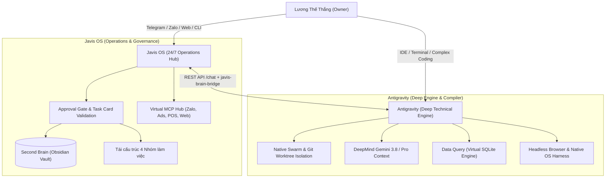

# Chiến lược Đồng Tiến hóa: Antigravity & Javis OS (Co-Evolution Protocol)

> Phiên bản v1.0 - Ngày ban hành: 2026-11-21  
> Định chế: Master Optimizer (Lương Thế Thắng)  
> Thành phần tham gia: **Antigravity (Google DeepMind Runtime)** & **Javis OS (Second Brain & Multi-Channel Workforce)**

---

## 1. NGUYÊN TẮC PHÂN CÔNG LAO ĐỘNG KỸ THUẬT

| Hệ thống | Phạm vi phụ trách chính | Công cụ và Hạ tầng cốt lõi |
|---|---|---|
| **Javis OS** | Trực ban 24/7, đa kênh (Telegram, Zalo, Web, CLI); Gate kiểm duyệt Task Card; quản trị Second Brain; theo dõi nhắc việc và lịch trình. | FastAPI, SQLite (`team.sqlite3`, `conversations.db`), MCP Hub, Honesty Guard, Sentinel. |
| **Antigravity** | Kỹ sư trưởng thiết kế kiến trúc, refactor mã nguồn phức tạp, lập trình thuật toán MQL4/MQL5, phân tích Big-O, kiểm chứng backtest lớn. | Gemini 3.8 Series (1M+ context), Native Swarm, Python Workflow Engine, Visual Browser Sandbox, Data Query. |

---

## 2. QUY CHẾ TÁI CẤU TRÚC 4 NHÓM LÀM VIỆC (INTELLIGENT RESTRUCTURING)

### Nhóm 1: Phòng Kỹ thuật và EA (`tm_1ad0288b2c9c73ba`)
- **Vấn đề cũ:** Báo "xong" khi chưa qua nghiệm thu thực tế; thiếu dữ kiện vẫn sinh code ảo.
- **Quy chế mới:**
  1. *Cổng tiền kiểm Task Card:* Mọi yêu cầu phải có đủ: Symbol, Timeframe, MagicNumber, StopLevel, SpreadPoints, Risk% tối đa. Thiếu dữ kiện bắt buộc trả `BLOCKED_INPUT`.
  2. *Cổng nghiệm thu bắt buộc (Strict Verification Gate):* Code bàn giao phải có bằng chứng compile không warning từ MetaEditor và pass bài test regression so với bản ổn định gần nhất (LKG - Last Known Good).
  3. *Bổ sung Antigravity Core:* Tham gia vai trò Kiến trúc sư Trưởng (Master Optimizer) phụ trách kiểm toán thuật toán, race condition và trượt giá (slippage).

### Nhóm 2: Phân tích Thị trường (`tm_e5a98e07bfc5db6b`)
- **Vấn đề cũ:** 9 thành viên trong 1 nhóm chat gây bùng nổ token và loãng trọng tâm.
- **Quy chế mới (Tam giác Cốt lõi - Core Triangle):**
  1. *Kiểm chứng Dữ liệu (Data Verifier):* Kiểm tra tính hợp lệ và thời gian thực của dữ liệu đầu vào. Chặn các dữ liệu quá hạn.
  2. *Tổng hợp Phân tích (CIO / Synthesizer):* Hợp nhất 3 góc nhìn (Vĩ mô, Dòng tiền, Kỹ thuật) thành 1 kịch bản hành động duy nhất.
  3. *Quản trị Rủi ro (Risk Governor):* Kiểm tra tỷ lệ Risk:Reward, khoảng cách an toàn Stop/Freeze Level, giữ quyền phủ quyết tuyệt đối (Veto).
  *(Các chuyên viên đơn lẻ chỉ được gọi khi có câu hỏi chuyên biệt)*.

### Nhóm 3: Ban Điều hành AI Company (`tm_abf04e8e74479b9e`)
- Điều phối liên phòng, giám sát SLA và chuẩn hóa quy trình chuyển giao sản phẩm cho chủ doanh nghiệp.

### Nhóm 4: Phòng Marketing và Nội dung (`tm_b5227064dc0d0bb7`)
- Xây dựng phễu nội dung, kiểm duyệt bản quyền và chất lượng trước khi nộp cho chủ duyệt.

---

## 3. VÒNG LẶP ĐỒNG TIẾN HÓA (CONTINUOUS CO-EVOLUTION LOOP)

1. **Javis ghi nhận phát hiện:** Trong quá trình trực ban hoặc chat với người dùng, nếu Javis gặp lỗi hệ thống, bottle-neck I/O hoặc thiếu công cụ, Javis tự động ghi fact vào `Brain Default/memory/facts/`.
2. **Antigravity phân tích và vá lỗi:** Antigravity định kỳ hoặc khi được kích hoạt sẽ đọc các fact mới qua `brain_bridge.py search`, phân tích nguyên nhân gốc (Root Cause Analysis) và trực tiếp sửa code/tối ưu hóa module.
3. **Shadow Testing và Đồng bộ:** Mọi bản vá được kiểm thử tự động, commit vào Git repo của Javis và thông báo cập nhật cho Javis Core qua endpoint `/chat`.
